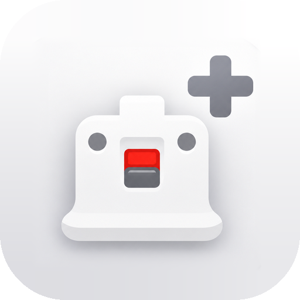

<h1 align="center">RevolutionMote+</h1>

<b>Tu móvil Android, convertido en el mando que necesites.</b> 
Mando de Wii, GamePad de Wii U, Pro Controller, mando de Xbox, touchpad, teclado y ratón: todo desde una sola app.

<b><a href="README.md">English</a></b> · <a href="https://github.com/daniel27bc/RevolutionMote-Plus/releases/latest">Descargas</a>

## Qué es

RevolutionMote+ es una **expansión de [PepoMote](https://github.com/pepitolas13/PepoMote)**, el proyecto creado por **PepoTech**. Todo el núcleo es suyo: el protocolo, el receptor de PC, el puntero con movimiento real, los modos de Wii, Wii U, Switch y RetroArch y el servidor Android.

Sobre esa base, RevolutionMote+ añade **versatilidad, funciones y personalización**, con un objetivo: ser **la herramienta más completa para usar un Android como dispositivo de entrada**, sea para emular consolas, para jugar a juegos de PC o para manejar el escritorio.

## Lo que añade RevolutionMote+

**Mando universal (Xbox) a tu medida**
- Editor de diseño completo: arrastra y pellizca cada control, con imán, deshacer y espejo para zurdos.
- Un ⚙ por control: tamaño, zona muerta, anti-zona muerta, sensibilidad, stick o trackpad, función y turbo.
- Perfiles con nombre, que puedes exportar e importar. Para empezar hay plantillas Xbox, Nintendo, PlayStation y Touchpad.
- **Sticks flotantes**: el stick aparece donde apoyas el pulgar, como en los juegos de móvil.
- **Cámara en el espacio libre**, al estilo de CoD Mobile, con inercia opcional.
- **Giroscopio** para apuntar:
  - activación siempre, al mantener o alternando (con un botón o con LT/ZL);
  - sensibilidad distinta en vertical y en horizontal;
  - suavizado e intercambio de ejes.
- Botones de **precisión** y **recentrar**.
- **Mando físico o telescópico** (Kishi, Backbone, GameSir…) reenviado al PC.

**Teclado y ratón**
- **Modo ratón** en el mando universal: A y B hacen clic, y si los mantienes y deslizas, arrastran. Los huecos libres funcionan como touchpad.
- **Touchpad completo**, como el de un portátil:
  - toque, doble toque, y doble toque mantenido para agarrar y arrastrar;
  - clic derecho y rueda con dos dedos, zoom pellizcando;
  - con tres dedos, vista de tareas, escritorio y cambio de ventana.
- **Pantalla de teclado y ratón** dedicada, que funciona de tres formas:
  - con el receptor de RevolutionMote+;
  - por **Bluetooth**, sin instalar nada en el PC;
  - con el receptor original de PepoTech, en modo puntero.

**Puntero de Wii mejorado**
- Tres formas de mover el cursor: apuntando con el móvil, con el dedo como trackpad, o las dos a la vez.
- Ajustes del puntero dentro del propio mando y selector de modos plegable.

**Comodidad**
- **Vibración** con aspecto de botón real:
  - niveles Suave, Media y Fuerte, o una vibración **personalizada** (fuerza, tipo de golpe y duración);
  - se elige qué controles vibran.
- **Ajustes** organizados por secciones, al estilo de un iPhone, con buscador.
- **Apariencia:** tema claro, oscuro u OLED y color de acento.
- **Pantalla de diagnóstico**, para ver en directo qué lee y qué envía el móvil.
- Candado de orientación, lado del mando apaisado configurable, pistas la primera vez y descripciones para TalkBack.

## Lo que hereda de PepoMote

- **Puntero**: apuntas con el móvil y el cursor del PC va justo ahí.
- **Dolphin**: el móvil hace de Wiimote con movimiento completo; también Nunchuk.
- **Wii U (Cemu)**: GamePad con giroscopio, pantalla táctil y doble pantalla.
- **Switch (Eden)**: Pro Controller.
- **RetroArch**: el mando de cada consola, el RetroPad o una pistola de luz.
- **Servidor Android**: otro Android ejecuta Dolphin, Eden o RetroArch y este hace de mando.

Guías detalladas: [Switch](docs/SETUP-SWITCH.md) · [RetroArch](docs/SETUP-RETROARCH.md) · [Servidor Android](docs/ANDROID-SERVER.md) · [Linux](docs/LINUX.md) · [macOS](docs/MACOS.md).

## Descargas

| Pieza | Plataforma | Dónde |
|---|---|---|
| App | Android 8.0 o superior | `RevolutionMote-Plus-vX.apk` en [Releases](https://github.com/daniel27bc/RevolutionMote-Plus/releases/latest) |
| Receptor con teclado y ratón | Windows 10/11 | `RevolutionMote-Plus-Receptor-Windows-vX.exe` en [Releases](https://github.com/daniel27bc/RevolutionMote-Plus/releases/latest) |
| Receptor original | Windows, Linux, macOS | [PepoMote](https://github.com/pepitolas13/PepoMote/releases): compatible, salvo las teclas sueltas y el ratón simultáneo |

## Instalar

1. **PC (Windows):** abre el `.exe` del receptor. No necesita instalación. Si el firewall pregunta, permite el acceso en *redes privadas*.
2. **Móvil:** instala el APK (permite «orígenes desconocidos»). Abre la app, toca **Conectar** y escanea el QR del PC.
3. **Sin PC con receptor:** el modo **Teclado y ratón por Bluetooth** funciona con cualquier equipo que tenga Bluetooth.

RevolutionMote+ se instala como app aparte (`dev.daniel27bc.revolutionmote`) y puede convivir con la PepoMote oficial.

## Créditos y licencia

- Proyecto original: **[PepoMote](https://github.com/pepitolas13/PepoMote)**, de **PepoTech**. Gracias por crearlo y publicarlo como software libre.
- RevolutionMote+: **daniel27bc**.
- Iconos de la interfaz: Material Symbols (Apache 2.0); ver `assets/licenses`.
- Licencia **GPLv3**, la misma que el original.
- Dolphin, RetroArch, Nintendo, Wii, Wii U, Switch, Xbox y PlayStation son marcas de sus respectivos dueños. Sus nombres y logotipos se usan solo para identificar con qué funciona cada modo. Este proyecto no está afiliado a ninguno de ellos.
