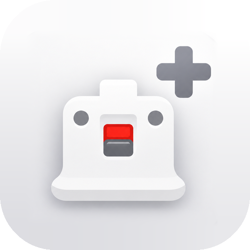

<h1 align="center">RevolutionMote+</h1>

<b>Your Android phone, turned into whatever controller you need.</b> 
Wii Remote, Wii U GamePad, Pro Controller, Xbox controller, touchpad, keyboard and mouse: all from one app.

<b><a href="README.es.md">Español</a></b> · <a href="https://github.com/daniel27bc/RevolutionMote-Plus/releases/latest">Downloads</a>

## What it is

RevolutionMote+ is an **expansion of [PepoMote](https://github.com/pepitolas13/PepoMote)**, the project created by **PepoTech**. The whole core is theirs: the protocol, the PC receiver, the true motion pointer, the Wii, Wii U, Switch and RetroArch modes and the Android server.

On top of that base, RevolutionMote+ adds **versatility, features and customisation**, with one goal: to be **the most complete tool for using an Android phone as an input device**, whether for emulating consoles, playing PC games or driving the desktop.

## What RevolutionMote+ adds

**A universal (Xbox) controller built your way**
- Full layout editor: drag and pinch every control, with snapping, undo and a left-handed mirror.
- A ⚙ per control: size, deadzone, anti-deadzone, sensitivity, stick or trackpad, function and turbo.
- Named profiles you can export and import. To get started there are Xbox, Nintendo, PlayStation and Touchpad templates.
- **Floating sticks**: the stick appears where your thumb lands, like in mobile games.
- **Free-space camera**, CoD Mobile style, with optional inertia.
- **Gyro aiming**:
  - activation always on, on hold or toggled (with a button or with LT/ZL);
  - separate portrait and landscape sensitivity;
  - smoothing and axis swap.
- **Precision** and **recenter** buttons.
- **Physical or telescopic controllers** (Kishi, Backbone, GameSir…) forwarded to the PC.

**Keyboard and mouse**
- **Mouse mode** on the universal controller: A and B click, and if you hold them and slide, they drag. Empty space works as a touchpad.
- **Full touchpad**, like a laptop's:
  - tap, double tap, and double tap held to grab and drag;
  - two-finger right click and scroll, pinch to zoom;
  - with three fingers, task view, desktop and window switching.
- Dedicated **keyboard and mouse screen**, which works three ways:
  - with the RevolutionMote+ receiver;
  - over **Bluetooth**, with nothing installed on the PC;
  - with PepoTech's original receiver, in pointer mode.

**Improved Wii pointer**
- Three ways to move the cursor: pointing the phone, using your finger as a trackpad, or both at once.
- Pointer settings inside the controller itself and a foldable mode selector.

**Comfort**
- **Vibration** that feels like a real button:
  - Soft, Medium and Strong levels, or a **custom** vibration (strength, hit type and length);
  - you choose which controls vibrate.
- iPhone-style **settings** with sections and search.
- **Appearance:** light, dark or OLED theme and accent colour.
- A **diagnostics screen** that shows live what the phone reads and sends.
- Orientation lock, configurable landscape side, first-time hints and TalkBack descriptions.

## What it inherits from PepoMote

- **Pointer**: point the phone and the PC cursor goes right there.
- **Dolphin**: the phone becomes a Wiimote with full motion; Nunchuk too.
- **Wii U (Cemu)**: GamePad with gyro, touch screen and dual screen.
- **Switch (Eden)**: Pro Controller.
- **RetroArch**: each console's controller, the RetroPad or a light gun.
- **Android server**: another Android phone runs Dolphin, Eden or RetroArch and this one is the controller.

Detailed guides: [Switch](docs/SETUP-SWITCH.md) · [RetroArch](docs/SETUP-RETROARCH.md) · [Android server](docs/ANDROID-SERVER.md) · [Linux](docs/LINUX.md) · [macOS](docs/MACOS.md).

## Downloads

| Piece | Platform | Where |
|---|---|---|
| App | Android 8.0 or later | `RevolutionMote-Plus-vX.apk` in [Releases](https://github.com/daniel27bc/RevolutionMote-Plus/releases/latest) |
| Receiver with keyboard and mouse | Windows 10/11 | `RevolutionMote-Plus-Receptor-Windows-vX.exe` in [Releases](https://github.com/daniel27bc/RevolutionMote-Plus/releases/latest) |
| Original receiver | Windows, Linux, macOS | [PepoMote](https://github.com/pepitolas13/PepoMote/releases): compatible, except for individual keys and simultaneous mouse |

## Install

1. **PC (Windows):** open the receiver `.exe`. No installation needed. If the firewall asks, allow access on *private networks*.
2. **Phone:** install the APK (allow "unknown sources"). Open the app, tap **Connect** and scan the QR code shown on the PC.
3. **No PC receiver:** **Keyboard and mouse over Bluetooth** works with any computer that has Bluetooth.

RevolutionMote+ installs as a separate app (`dev.daniel27bc.revolutionmote`) and can live alongside the official PepoMote.

## Credits and licence

- Original project: **[PepoMote](https://github.com/pepitolas13/PepoMote)** by **PepoTech**. Thank you for creating it and releasing it as free software.
- RevolutionMote+: **daniel27bc**.
- UI icons: Material Symbols (Apache 2.0); see `assets/licenses`.
- Licence **GPLv3**, the same as the original.
- Dolphin, RetroArch, Nintendo, Wii, Wii U, Switch, Xbox and PlayStation are trademarks of their respective owners. Their names and logos are used only to identify what each mode works with. This project is not affiliated with any of them.
