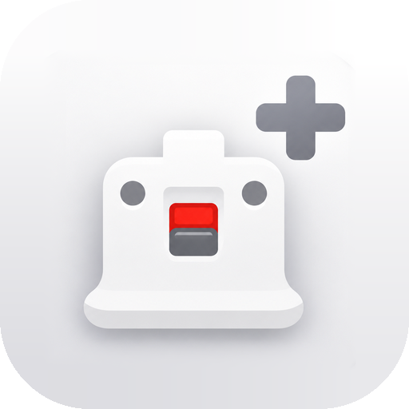

Primera versión de **RevolutionMote+**, un fork comunitario de [PepoMote](https://github.com/PepoTechYT/PepoMote) de **PepoTech**. Todo el mérito del núcleo (protocolo, receptor de PC y modos de Wii, Wii U, Switch y RetroArch) es suyo. Para usarlo necesitas el receptor de PepoMote en el PC, igual que con la app original.

Se instala como app aparte (`dev.daniel27bc.revolutionmote`) y puede convivir con la PepoMote oficial.

### Novedades

- **Editor de diseño completo** (☰ Mando → Editar diseño): arrastra y pellizca cada control, quita y añade controles, cambia la opacidad y guarda perfiles con nombre (crear, duplicar, renombrar y borrar).
- **⚙ en cada control**: tamaño; en los sticks, zona muerta, anti-zona muerta, sensibilidad y modo stick o trackpad, con la curva de respuesta en vivo; en los botones, función, forma y turbo.
- **Cámara en el espacio libre**, como en CoD Mobile: desliza en cualquier hueco sin controles para girar la cámara. El stick o trackpad derecho sigue sirviendo para los menús.
- **Modo trackpad** en los sticks: va por la velocidad del dedo y no se queda girando si dejas el dedo quieto.
- **Apuntar con el giroscopio** (mando universal): giro horizontal real lo sujetes como lo sujetes. Se activa siempre, al mantener LT / ZL, alternando con LT / ZL o con el botón 🎯 (mantener o alternar). Sensibilidad por eje hasta 10x, invertir, intercambiar ejes, anti-zona muerta y suavizado.
- **Modo ratón** en el mando universal (☰ Mando): el giro mueve el ratón del PC, A hace clic izquierdo y B clic derecho, sin salir del mando.
- **Ratón con el dedo**: en modo puntero (mando de Wii o modo ratón), desliza en cualquier hueco para mover el cursor como en el trackpad de un portátil.
- **Inercia** opcional en todos los trackpads y sensibilidades de 0,1x a 10x con sliders en escala logarítmica.
- **Mando físico o telescópico** (USB, Bluetooth, Kishi, Backbone, GameSir…) reenviado al PC a través de la app, junto con el giroscopio del móvil. Los botones se asignan por posición según la plantilla.
- **Botones de volumen** asignables a cualquier botón, gatillos incluidos.
- **Vibración de clic nítido** con cuatro niveles, modo compatible y botón de prueba.
- **Candado de orientación** en el mando.
- Mejor legibilidad en toda la app: opciones con contraste que no se cortan, textos más grandes y el menú del mando arriba, sin tapar controles.
