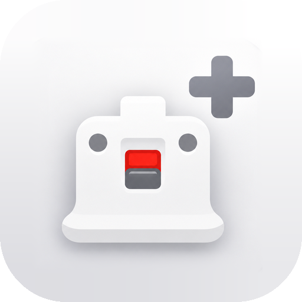

### Descargas

- **RevolutionMote-Plus-v1.1.0.apk**: la app para el móvil.
- **RevolutionMote-Plus-Receptor-Windows-v1.1.0.exe**: el receptor de PepoMote para el PC con el **teclado y ratón** de RevolutionMote+. Es compatible con todo lo de PepoMote (Wii, Wii U, Switch, RetroArch, mando universal), así que puede sustituir al receptor original. Sin él, la app sigue funcionando con el receptor de PepoTech, pero sin teclado y ratón a la vez que el mando.

### Novedades

**Teclado y ratón** (nueva tarjeta en el inicio)
- Touchpad grande (un dedo mueve, toque = clic, dos dedos = clic derecho y rueda), clic izquierdo, central y derecho, teclas especiales (Esc, Tab, flechas, F1–F12…), Ctrl, Alt, Shift y Win que se quedan pulsadas para combinaciones, campo para escribir y el giro del móvil como ratón.
- Al entrar eliges **por la app** (wifi, con el receptor de RevolutionMote+; teclas reales que leen también los juegos) o **por Bluetooth** (el móvil se empareja como teclado y ratón de verdad con el PC, la tele o la tablet, sin instalar nada). Puedes dejar una opción como predeterminada y cambiarla desde la propia pantalla.

**Mando universal como navaja suiza**
- Con el receptor de RevolutionMote+, el **ratón y el mando funcionan a la vez**: el interruptor mando / ratón ya no cambia el modo del PC.
- Control nuevo **Tecla** (Esc, WASD, F5, Ctrl…), tantas como quieras, a la vez que el mando.
- **Interruptor mando / ratón**, **touchpad de ratón**, **clics** y **teclado** colocables donde quieras.
- En modo ratón el cursor se mueve en relativo, como un ratón de verdad: no se descentra. Con el receptor original de PepoTech, el modo ratón usa el modo puntero.

**Más**
- Ratón con el dedo en el mando de Wii (modo puntero): arreglado.
- Giroscopio del mando universal con sensibilidad separada en horizontal y en vertical. El modo puntero queda como en PepoMote.
- Tema **OLED** (negro puro), además de Sistema, Claro y Oscuro.
- Iconos de **Material Symbols** (Google, Apache 2.0) en lugar de emojis.

> Si tenías instalada la v1.0.0, desinstálala antes de instalar esta: cada compilación lleva una firma de depuración distinta hasta que el repositorio tenga su clave de firma.
